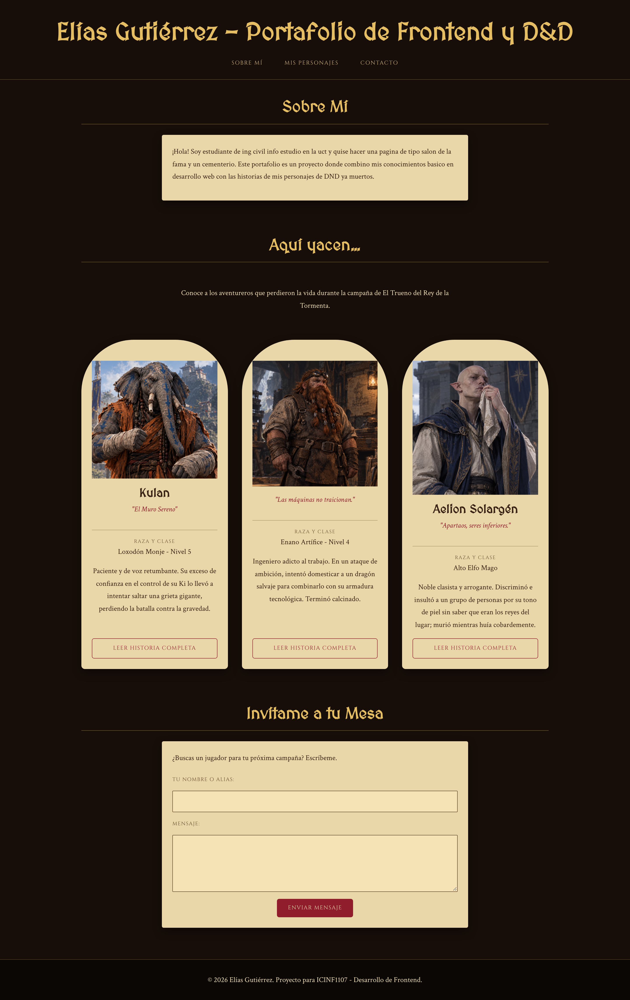
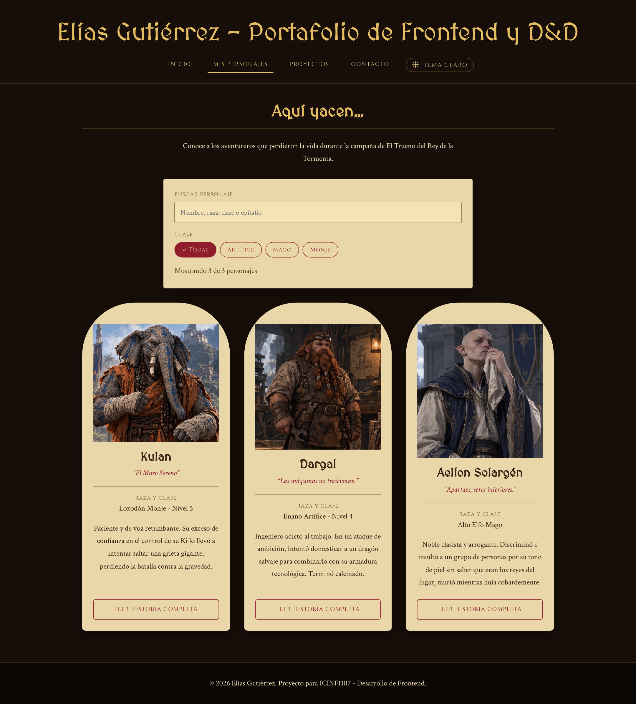

# Cementerio de Aventureros D&D — Portafolio en React

**Evaluación N°4 · Proyecto Integrado Final (PIF) · Desarrollo de Frontend (ICINF1107)**
Universidad Católica de Temuco · Ingeniería Civil en Informática · Autor: Elías Gutiérrez

## 1. Descripción y referencia visual

Migración del portafolio estático de la **Evaluación N°2** (HTML + CSS) a una *Single Page Application* con
**React 19 + TypeScript (modo estricto) + React Router 7**, construida con **Vite**. Es un cementerio
conmemorativo de mis personajes de D&D ya muertos, con consumo de la **GitHub REST API**, tema claro/oscuro,
filtro de personajes y formulario de contacto validado.

| Evaluación N°2 (original) | Evaluación N°4 (React) |
| --- | --- |
|  |  |

- Captura de contraste exigida: [`docs/captura-e2.png`](docs/captura-e2.png) (2880 × 4568 px).
- El repositorio de la E2 se mantiene intacto: <https://github.com/rosbosman/cementerio-de-aventureros-DYD>.
- Trazabilidad de la migración: [`INVENTARIO.md`](INVENTARIO.md). Declaración de uso de IA: [`uso_ia.md`](uso_ia.md).

## 2. Rutas de la aplicación

| Ruta | Vista | Notas |
| --- | --- | --- |
| `/` | `HomePage` | "Sobre Mí" |
| `/personajes` | `CharactersPage` | Cementerio con filtro por texto y clase |
| `/personajes/:characterId` | `CharacterDetailPage` | Parámetro de ruta con `useParams` |
| `/proyectos` | `ProjectsPage` | Repositorios desde la GitHub REST API |
| `/contacto` | `ContactPage` | Formulario controlado con validación |
| `*` | `NotFoundPage` | Ruta comodín 404 |

La navegación usa solo `BrowserRouter`, `Routes`, `Route`, `NavLink` y `Link`; no hay anclas `#seccion` ni
manipulación de `window.location`. La ruta activa se marca con `.navbar__link--active` y `aria-current="page"`.

## 3. Contrato técnico de la API (Alternativa A — GitHub REST)

| Elemento | Valor |
| --- | --- |
| URL base | `https://api.github.com` |
| Endpoint | `GET /users/{usuario}/repos` |
| Usuario | `rosbosman` (definido en `src/data/portfolioData.ts`) |
| Parámetros | `sort=updated` (más recientemente actualizados primero) · `per_page=6` |
| URL final | `https://api.github.com/users/rosbosman/repos?sort=updated&per_page=6` |
| Autenticación | Ninguna (API pública, sin claves que exponer). Límite: 60 consultas/hora por IP |
| Construcción de la URL | `buildReposUrl()` en `src/services/apiService.ts` |

**Estructura JSON esperada** (solo se tipan los campos que se usan; ver `GitHubRepo` en `src/types/index.ts`):

```json
[
  {
    "id": 123456789,
    "name": "cementerio-de-aventureros-DYD",
    "description": "Texto o null",
    "html_url": "https://github.com/rosbosman/cementerio-de-aventureros-DYD",
    "language": "HTML",
    "stargazers_count": 0,
    "updated_at": "2026-11-05T14:00:00Z"
  }
]
```

**Ciclo de vida asíncrono.** `useFetchApi<T>(url)` (`src/hooks/useFetchApi.ts`) usa `fetch` nativo dentro de
`useEffect` y expone `{ data, loading, error, retry }`. La función de limpieza llama a
`AbortController.abort()` para cancelar la petición pendiente al desmontar la vista o cambiar la URL
(previene condiciones de carrera). Los errores se traducen a mensajes para el usuario final:

| Situación | Mensaje mostrado |
| --- | --- |
| HTTP 403 / 429 | GitHub limitó temporalmente las consultas (60 por hora sin autenticación) |
| HTTP 404 | No se encontró el usuario de GitHub indicado |
| HTTP 5xx | El servidor de GitHub no está disponible en este momento |
| Sin red (`TypeError`) | No se pudo conectar con el servidor. Revisa tu conexión |
| Lista vacía | Este usuario aún no tiene repositorios públicos |

La vista muestra *cargando* (`role="status"`), *error* con botón **Reintentar** (`role="alert"`), *vacío* y *éxito*.

**Justificación de la elección.** Elegí GitHub porque el portafolio es el lugar natural para mostrar código real y
se mantiene solo: cada repositorio nuevo o actualizado aparece sin tocar el sitio. Además no requiere API Key,
devuelve JSON simple de tipar y permite practicar los tres estados (carga, éxito, error) con un caso real: el
límite de 60 consultas por hora hace que el manejo de errores sea una necesidad y no un adorno.

## 4. Guía de ejecución y despliegue

Requisitos: **Node.js 20.19+ o 22.12+** y npm.

```bash
# 1. Instalación de dependencias del proyecto
npm install

# 2. Servidor de desarrollo con Hot Module Replacement (http://localhost:5173)
npm run dev

# 3. Verificación de tipos (tsc) y empaquetado de producción en dist/
npm run build

# 4. Previsualización local de la compilación de producción (http://localhost:4173)
npm run preview
```

> `npm audit` informa advertencias de severidad alta en `picomatch` (ReDoS), una dependencia transitiva de Vite
> usada solo en tiempo de compilación; no forma parte del código que se publica en `dist/`. La corrección
> automática exige degradar Vite a una versión anterior, por lo que se dejó como está.

Otros scripts: `npm run lint` (oxlint, incluye reglas de accesibilidad y `typescript/no-explicit-any` como error),
`npm run format` y `npm run format:check` (Prettier).

**Despliegue.** `npm run build` genera la carpeta `dist/`, que es un sitio estático. Como la app usa
`BrowserRouter`, el hosting debe responder con `index.html` para cualquier ruta (por ejemplo `/personajes`);
`npm run preview` ya lo hace. En Netlify basta una regla `/* /index.html 200`; en Vercel, un *rewrite* equivalente.

## 5. Arquitectura

```
src/
├── components/   Componentes con una sola responsabilidad, cada uno con su CSS (BEM)
├── context/      ThemeContext.tsx (Context API: tema claro/oscuro)
├── data/         portfolioData.ts (datos estáticos tipados, recuperados de la E2)
├── hooks/        useFetchApi, useTheme, useDocumentTitle
├── pages/        Vistas asociadas a React Router
├── services/     apiService.ts (funciones puras de comunicación HTTP)
├── types/        index.ts (todas las interfaces y tipos; sin `any`)
├── utils/        Filtro de personajes y validación del formulario (funciones puras)
├── App.tsx       BrowserRouter, Routes y Layout
└── main.tsx      Punto de entrada
```

| Requerimiento | Dónde se cumple |
| --- | --- |
| RF-02 Componentes + TypeScript estricto | `tsconfig.app.json` (`strict`), `src/types/`, `oxlint` prohíbe `any` |
| RF-03 React Router | `App.tsx`, `Navbar.tsx` (`NavLink`), `NotFoundPage.tsx` (`path="*"`) |
| RF-04 API REST | `apiService.ts`, `useFetchApi.ts`, `ProjectsPage.tsx` |
| RF-05 Estado local y transversal | `CharactersPage` (estado elevado) + `ThemeContext` |
| RF-06 Interactividad en React | Menú hamburguesa, tema, filtro y formulario (ver `INVENTARIO.md`) |
| RNF-01 BEM | Un `.css` por componente; ejemplos: `.project-card__title`, `.navbar__link--active` |
| RNF-02 Accesibilidad | HTML5 semántico, `htmlFor`/`id`, ARIA, `:focus-visible`, mobile-first desde 320 px |
| RNF-03 Git/GitHub | Ramas por funcionalidad, Conventional Commits y Pull Requests (sección 7) |

## 6. Auditoría de accesibilidad

Resultados medidos sobre la compilación de producción (detalle completo en
[`docs/AUDITORIA.md`](docs/AUDITORIA.md)):

| Herramienta | Resultado |
| --- | --- |
| Google Lighthouse 13.6 (Inicio, Personajes, Contacto; móvil y escritorio) | Accesibilidad **100**, Buenas prácticas **100**, SEO **100**, Rendimiento **99–100**, CLS **0** |
| axe-core 4.x (WCAG 2.0/2.1 A y AA) | **0 violaciones** en 24 combinaciones de vista × tema × ancho (320 px y 1280 px) |
| Navegación por teclado | Todos los elementos enfocables muestran `:focus-visible`; botón "Saltar al contenido"; Escape cierra el menú |
| Contraste | Todos los pares texto/fondo superan 4,5:1 en tema oscuro y claro |

Captura del foco visible: [`docs/foco-teclado.png`](docs/foco-teclado.png).

## 7. Flujo de trabajo Git

Se trabajó con ramas por funcionalidad, *Conventional Commits* y Pull Requests con descripción técnica,
fusionados a `main` con *merge commit*:

| Rama | Contenido |
| --- | --- |
| `feat/tipos-y-datos` | Tipos TypeScript, datos de la E2 en `src/data/`, imágenes optimizadas |
| `feat/rutas` | Layout, Navbar con `NavLink`, vistas Inicio/Personajes/detalle y 404 |
| `feat/estado-tema` | `ThemeContext`, `useTheme`, tema claro y menú hamburguesa |
| `feat/consumo-api` | `apiService`, `useFetchApi`, `StatusMessage`, `ProjectsPage` |
| `feat/filtro-personajes` | Filtro por texto y clase con estado elevado |
| `feat/formulario-contacto` | Formulario controlado con validación y ARIA |
| `style/a11y-rendimiento` | Fuentes autoalojadas, `robots.txt`, Prettier y auditoría |
| `docs/documentacion` | `README.md`, `INVENTARIO.md` y `uso_ia.md` |

```bash
git log --oneline --graph --all   # historial completo
```
